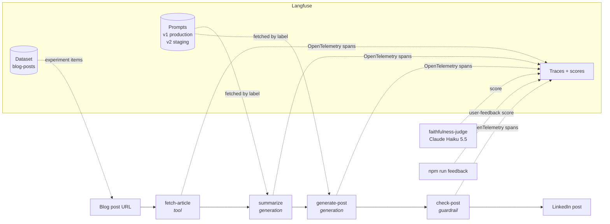
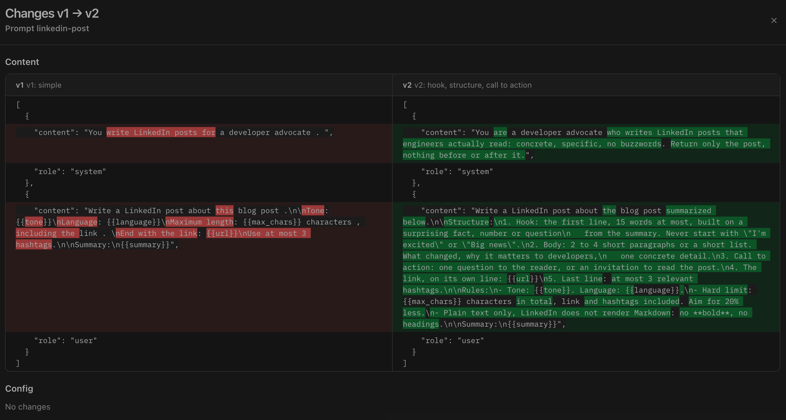
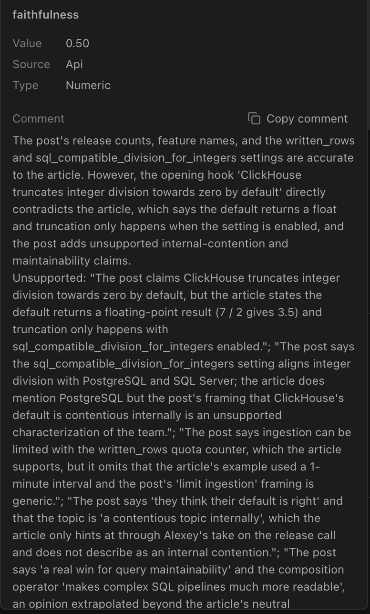

# Blog post → LinkedIn post, observed with Langfuse

A small TypeScript CLI that turns a technical blog post into a LinkedIn post, and uses
[Langfuse](https://langfuse.com) to answer the questions you get once an LLM feature works:

- **What happened?** Every run is one trace: fetch, summarize, generate, rule check, with tokens,
  cost and latency per step.
- **Which prompt was it?** Prompts live in Langfuse, versioned and labeled. Changing the
  `production` label changes the app's behavior without a deploy.
- **Is the new version better?** Experiments run the pipeline over a dataset of 16 blog posts and
  score every output: rules checked in code, plus an LLM judge for faithfulness to the article.
- **Is a cheaper or local model good enough?** Run the same experiment with another model and
  compare the two runs side by side.
- **Do people like it?** Thumbs up / down on a post becomes a score on its trace.

The full story, with the results and what went wrong along the way:
[Local LLM vs Claude: measuring the difference with Langfuse experiments](https://vntp.fr/en/blog/local-llm-vs-claude-langfuse-experiments/).


## How it works



- **Models** sit behind a `<provider>:<model>` string: `anthropic:claude-haiku-5-5` (default),
  `openrouter:google/gemma-3-12b-it`, `lmstudio:gemma-3-12b-it-qat` (local, LM Studio or LM Studio Bionic).
- **Rule check** is plain code: at most 1,300 characters, the link is in the post, at most 3 hashtags.
- **Judge** is Claude Haiku 5.5 by default, whatever model wrote the post, so runs stay comparable.
  `--judge` swaps it or adds more judges.

## Quickstart (5 minutes)

You need Node 22+, Docker, and an Anthropic API key.

```bash
git clone https://github.com/flovntp/langfuse-linkedin-demo && cd langfuse-linkedin-demo
npm install
cp .env.example .env          # then set ANTHROPIC_API_KEY
npm run langfuse:up           # local Langfuse on http://localhost:3000 (login in .env)
npm run setup                 # prompts v1/v2 + the blog-posts dataset
npm run run -- https://langfuse.com/blog/2025-06-04-open-sourcing-langfuse-product
```

The last command prints the post and a link to its trace. Prefer Langfuse Cloud? Put your
project's keys and `LANGFUSE_BASE_URL=https://cloud.langfuse.com` in `.env` and skip
`langfuse:up`.

## The five steps

Each step can be run on its own. What to look at in the UI is in [DEMO.md](DEMO.md).

| Step | Command | In Langfuse |
|---|---|---|
| 1. Tracing | `npm run run -- <url>` | **Tracing → Traces**: one trace per run, nested spans, cost |
| 2. Prompt management | `npm run run -- <url> --label=staging` | **Prompts**: v1 / v2, diff, metrics per version |
| 3. Dataset | `npm run setup` | **Datasets → blog-posts**: 16 items |
| 4. Experiments | `npm run experiment -- --model=<provider:model> --label=<label>` | **Datasets → blog-posts → Experiments → Compare** |
| 5. Feedback | `npm run feedback -- up\|down ["comment"]` | `user-feedback` score on the last trace |
| Cleanup | `npm run cleanup` (list), `npm run cleanup -- <id> --yes` | Removes a test experiment (v4 has no delete button) |

Useful flags: `--model`, `--label`, `--lang` (default English), `--tone`, `--max-chars`, and on
experiments `--limit=N` for a quick try and `--judge=<provider:model>` (repeatable: every judge
scores the same posts, as `faithfulness`, `faithfulness:<model>`…).



To add your own posts to the dataset, edit `MY_POSTS` in
[src/setup/dataset-items.ts](src/setup/dataset-items.ts) and run `npm run setup` again.

## Results

Same 16 posts, same judge (Claude Haiku 5.5), **3 runs per configuration**, averaged:

| Run | Posts passing every rule | Avg faithfulness (min–max) | Generation cost (16 posts) | Time per post |
|---|---|---|---|---|
| Claude Haiku 5.5, prompt v1 | 71% | **0.78** (0.73–0.84) | $0.018 | 8 s |
| Claude Haiku 5.5, prompt v2 | **96%** | **0.78** (0.77–0.80) | $0.016 | 7 s |
| Gemma 3 12B (OpenRouter), prompt v2 | **100%** | 0.67 (0.66–0.67) | $0.004 | 13–24 s |
| Gemma 3 12B QAT 4-bit (local, M2 24 GB), prompt v2 | **100%** | 0.64 (0.61–0.67) | **$0** | 75 s |

- **Prompt v2 fixes the format, not the facts.** It passes the rules far more often (+25 points)
  but is not more faithful. With one run each, v2 looked more faithful (0.77 vs 0.73): that was noise.
- **Gemma follows the rules just as well, but states more things the article does not say**, about
  0.11–0.14 below Claude, in every run. On the ClickHouse 26.10 release notes, one of its hooks
  claims integer division truncates by default; the article says the opposite. Only the judge
  catches it: the code checks pass.
- **Local vs hosted Gemma**: 0.64 vs 0.67, within the spread of the local runs. No clear cost of
  4-bit quantization here, and no clear proof there is none either.

**Is the judge biased?** Same two `staging` runs, each post scored by both judges:

| Judge | Claude posts | Gemma posts | Ranking |
|---|---|---|---|
| Claude Haiku 5.5 | 0.77 | 0.67 | Claude ahead |
| Gemma 3 12B | 0.75 | 0.78 | Gemma slightly ahead |

The ranking depends on the judge. The Gemma judge gives 0.75 to almost everything and its
reasons are vague (it marked Claude's correct "7 / 2 returns 3.5" post down to 0.5), while the
Claude judge cites the article line by line. So: check your judge on posts where you know the
answer before trusting its ranking, and treat a gap measured by a single judge as a hypothesis.


Click Gemma's `faithfulness` score to read why the judge gave 0.5:



## Things this demo ran into

- **Thinking tokens count against `max_tokens`.** Claude Haiku 5.5 thinks by default. With
  `max_tokens: 1024`, a third of the summaries and posts were silently cut off. The providers now
  report truncation and the generation is marked `WARNING`; the prompt config sets 8,000.
- **Double-counted cost.** Recent Anthropic SDKs emit their own OpenTelemetry span per call, which
  Langfuse shows as a second generation. We trace calls ourselves (with the prompt version), so
  the client is created with `openTelemetry: false`.
- **Evaluators run outside the item's trace**, so the judge's cost is not added to the pipeline's.
  The judge has its own trace (`faithfulness-judge`, tag `judge`).
- **Langfuse v4 reads.** Some public read endpoints (traces, scores) are off in v4's events-only
  mode. The UI has everything; for scripts, use `/api/public/v2/observations`. There is no way
  to delete an experiment either: delete its item traces (`npm run cleanup`).

## Project layout

```
src/
  cli/          run.ts, experiment.ts, feedback.ts
  pipeline/     fetch, summarize, generate, check (one Langfuse observation each)
  providers/    anthropic, openai-compatible (LM Studio, OpenRouter)
  experiment/   evaluators.ts (rules + run summary), judge.ts (LLM-as-a-judge)
  setup/        seed prompts and dataset
  prompts.ts    the two prompt versions, fetched from Langfuse by label
  llm.ts        turns one LLM call into a Langfuse generation
scripts/        langfuse.sh (local self-hosted Langfuse)
```
