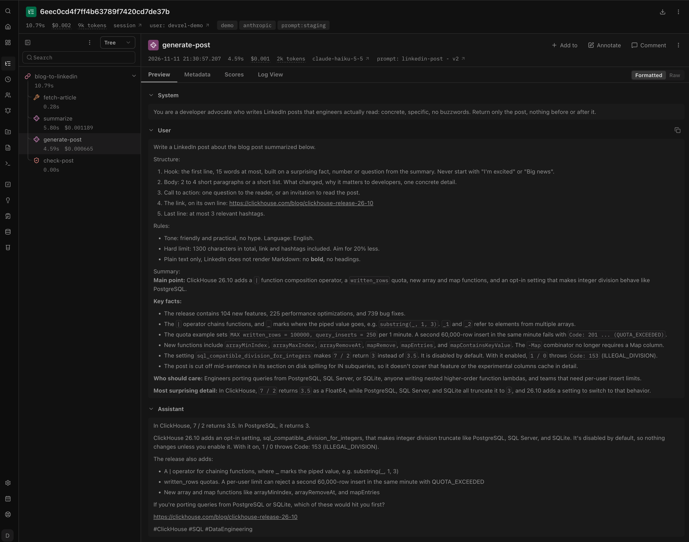
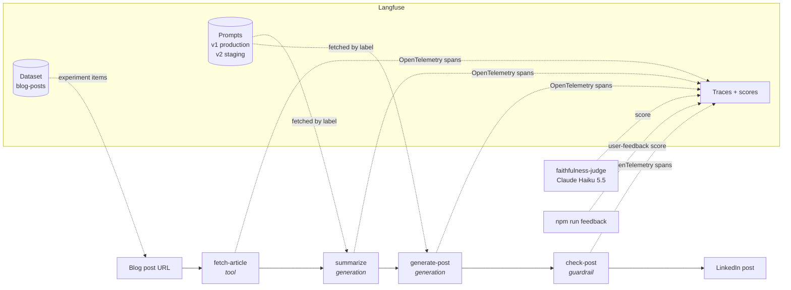
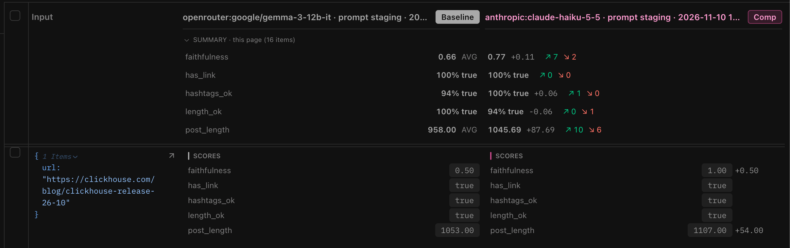

# Blog post → LinkedIn post, observed with Langfuse

A small TypeScript CLI that turns a technical blog post into a LinkedIn post, and uses
[Langfuse](https://langfuse.com) to answer the questions you get once an LLM feature works:

- **What happened?** Every run is one trace: fetch, summarize, generate, rule check, with tokens,
  cost and latency per step.
- **Which prompt was it?** Prompts live in Langfuse, versioned and labeled. Changing the
  `production` label changes the app's behavior without a deploy.
- **Is the new version better?** Experiments run the pipeline over a dataset of 16 blog posts and
  score every output: rules checked in code, plus an LLM judge for faithfulness to the article.
- **Is a cheaper or local model good enough?** Run the same experiment with another model and
  compare the two runs side by side.
- **Do people like it?** Thumbs up / down on a post becomes a score on its trace.

<!-- Screenshot: one trace in the Langfuse UI (fetch-article → summarize → generate-post → check-post) -->


## How it works



- **Models** sit behind a `<provider>:<model>` string: `anthropic:claude-haiku-5-5` (default),
  `openrouter:google/gemma-3-12b-it`, `lmstudio:google/gemma-3-12b` (local).
- **Rule check** is plain code: at most 1,300 characters, the link is in the post, at most 3 hashtags.
- **Judge** is always Claude Haiku 5.5, whatever model wrote the post, so runs stay comparable.

## Quickstart (5 minutes)

You need Node 22+, Docker, and an Anthropic API key.

```bash
git clone https://github.com/<you>/langfuse-linkedin-demo && cd langfuse-linkedin-demo
npm install
cp .env.example .env          # then set ANTHROPIC_API_KEY
npm run langfuse:up           # local Langfuse on http://localhost:3000 (login in .env)
npm run setup                 # prompts v1/v2 + the blog-posts dataset
npm run run -- https://langfuse.com/blog/2025-06-04-open-sourcing-langfuse-product
```

The last command prints the post and a link to its trace. Prefer Langfuse Cloud? Put your
project's keys and `LANGFUSE_BASE_URL=https://cloud.langfuse.com` in `.env` and skip
`langfuse:up`.

## The five steps

Each step can be run on its own. What to look at in the UI is in [DEMO.md](DEMO.md).

| Step | Command | In Langfuse |
|---|---|---|
| 1. Tracing | `npm run run -- <url>` | **Tracing → Traces**: one trace per run, nested spans, cost |
| 2. Prompt management | `npm run run -- <url> --label=staging` | **Prompts**: v1 / v2, diff, metrics per version |
| 3. Dataset | `npm run setup` | **Datasets → blog-posts**: 16 items |
| 4. Experiments | `npm run experiment -- --model=<provider:model> --label=<label>` | **Datasets → blog-posts → Runs → Compare** |
| 5. Feedback | `npm run feedback -- up\|down ["comment"]` | `user-feedback` score on the last trace |

Useful flags: `--model`, `--label`, `--lang` (default English), `--tone`, `--max-chars`, and
`--limit=N` on experiments for a quick try.

To add your own posts to the dataset, edit `MY_POSTS` in
[src/setup/dataset-items.ts](src/setup/dataset-items.ts) and run `npm run setup` again.

## Results from one afternoon

Same 16 posts, same judge, one run each (LLM output varies, so treat small gaps as noise):

| Run | Posts passing every rule | Avg faithfulness | Generation cost (16 posts) | Time per post |
|---|---|---|---|---|
| Claude Haiku 5.5, prompt v1 | 69% | 0.73 | $0.018 | 8 s |
| Claude Haiku 5.5, prompt v2 | **94%** | **0.77** | $0.017 | 7 s |
| Gemma 3 12B (OpenRouter), prompt v2 | **100%** | 0.66 | **$0.004** | 24 s |

Gemma follows the rules just as well, but states more things the article does not say. On the
ClickHouse 26.10 release notes, its hook claims integer division truncates by default; the article
says the opposite. Only the judge catches it: the code checks pass.

<!-- Screenshot: the Compare view with the two staging runs side by side -->


## Things this demo ran into

- **Thinking tokens count against `max_tokens`.** Claude Haiku 5.5 thinks by default. With
  `max_tokens: 1024`, a third of the summaries and posts were silently cut off. The providers now
  report truncation and the generation is marked `WARNING`; the prompt config sets 8,000.
- **Double-counted cost.** Recent Anthropic SDKs emit their own OpenTelemetry span per call, which
  Langfuse shows as a second generation. We trace calls ourselves (with the prompt version), so
  the client is created with `openTelemetry: false`.
- **Evaluators run outside the item's trace**, so the judge's cost is not added to the pipeline's.
  The judge has its own trace (`faithfulness-judge`, tag `judge`).
- **Langfuse v4 reads.** Some public read endpoints (traces, scores) are off in v4's events-only
  mode. The UI has everything; for scripts, use `/api/public/v2/observations`.

## Project layout

```
src/
  cli/          run.ts, experiment.ts, feedback.ts
  pipeline/     fetch, summarize, generate, check (one Langfuse observation each)
  providers/    anthropic, openai-compatible (LM Studio, OpenRouter)
  experiment/   evaluators.ts (rules + run summary), judge.ts (LLM-as-a-judge)
  setup/        seed prompts and dataset
  prompts.ts    the two prompt versions, fetched from Langfuse by label
  llm.ts        turns one LLM call into a Langfuse generation
scripts/        langfuse.sh (local self-hosted Langfuse)
```
